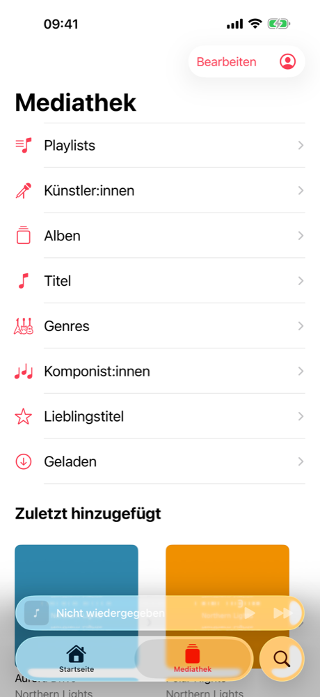
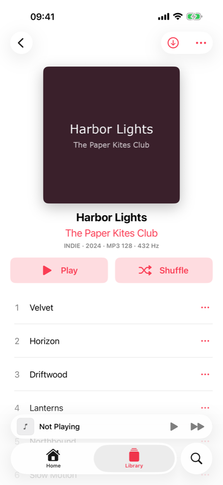
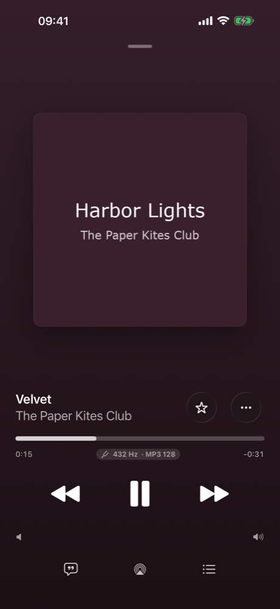
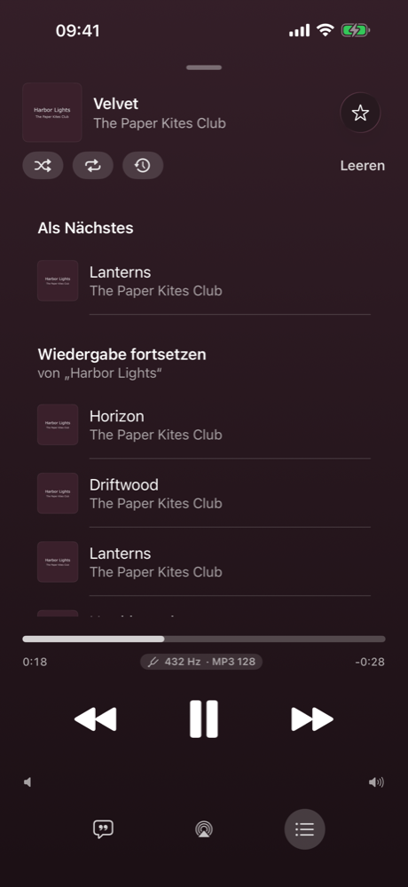
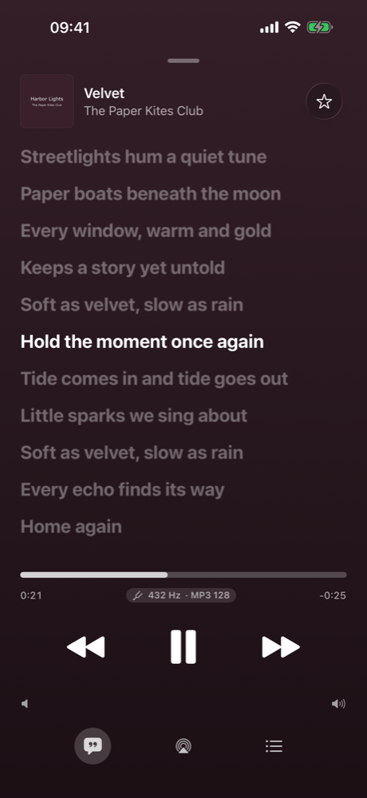
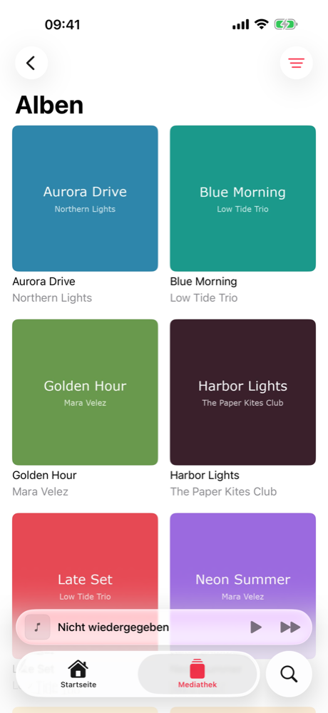
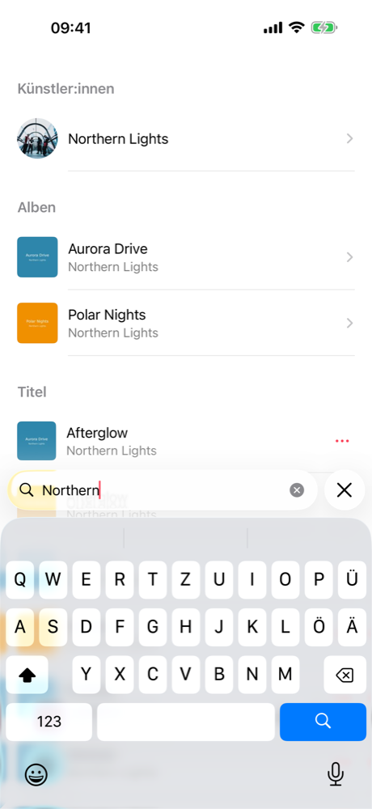
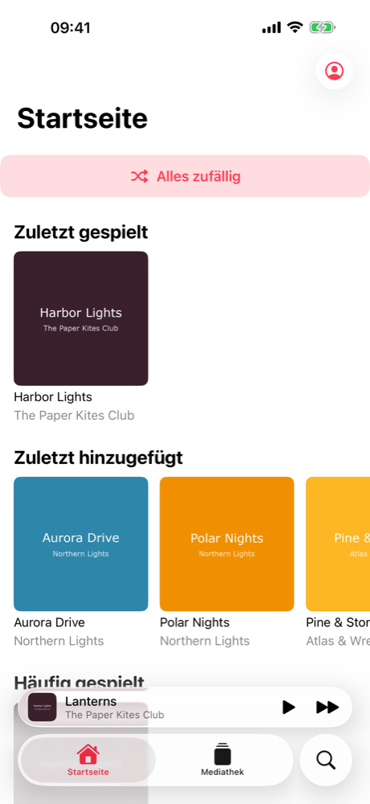

# HomeTune

**A native iOS music app for your own [Navidrome](https://www.navidrome.org) server – the look and feel of the Library in Apple's Music app, and every song plays in 432 Hz.**

HomeTune is an independent iPhone client for self-hosted Navidrome (or any Subsonic/OpenSubsonic server). It aims to feel like the Music app on iOS 26 (library sections, album and artist pages, mini player, full-screen player, "Playing Next" queue, lyrics …) while your music stays on hardware you own.

> **432 Hz is the core feature, not a setting.** Every track is pitched down by 1200·log2(432/440) ≈ **−31.77 cents** (A4 = 432 Hz instead of 440 Hz) on the device, with the tempo unchanged. A small "432 Hz" badge in the player shows it.
>
> **Status:** first version, tested against Navidrome 0.64 with MP3, AAC/ALAC and FLAC (up to 24 bit/96 kHz). UI in **English and German** (follows the iPhone language). Code comments are in German.
>
> Built with help from [Claude Code](https://claude.com/claude-code): Apple's Music app was analysed (names and texts only, see the HomeRoll series), the design decisions and testing are mine, a lot of the Swift was written together with it.
>
> **Personal project:** no guarantees, no support promises. Bug reports and pull requests are welcome, but I answer when I have time.
>
> Not affiliated with Apple or Navidrome. "Navidrome" is a trademark of its owners.

<p align="center">
  
  
  
  
  
</p>
<p align="center">
  
  
  
</p>
<p align="center"><sub>Screenshots with generated demo albums and made-up demo lyrics (no real music).</sub></p>

## Features

**Library**
- Sections like Music: Playlists, Artists, Albums, Songs, Genres, Composers, Favorite Songs, Downloaded – show, hide and reorder them (*Edit*)
- *Recently Added* grid below the sections, a Home tab with Recently Played, Recently Added, Heavy Rotation, Favorites, Random Albums and *Shuffle All*
- Sort (title, artist, recently added, recently played, release date, A–Z/Z–A), filter (favorites, downloaded), grid or list, *Find in …*
- Album pages with disc grouping, format line (e.g. `FLAC 24/96 · 432 Hz`), "More by …"; artist pages with top songs and albums
- Context menus per object type (song, album, artist, playlist, genre) and swipe actions (*Play Next* / *Play Last*), like Apple's menu providers
- Favorites (stars) synced with Navidrome, offline library cache

**Playback**
- Original files (`stream?format=raw`), so FLAC and ALAC stay lossless; formats iOS can't read are fetched as FLAC from the server
- `AVAudioEngine` → `AVAudioUnitTimePitch` (−31.77 cents, rate 1, overlap 32) → peak limiter
- **Gapless**: the next song is preloaded and scheduled sample-exactly behind the current one
- Queue modelled after Apple's: *Play Next*, *Play Last*, *Continue Playing from …*, history, drag to reorder, swipe to remove, *Clear*; shuffle and repeat (off/all/one); the queue survives a restart
- Mini player as `tabViewBottomAccessory`, full-screen player with zoom transition, cover colors, scrubbing, volume, AirPlay
- Lock screen / Control Center / headphone controls (play, pause, next, previous, scrubbing, shuffle, repeat), background audio, interruptions and route changes
- Synced lyrics (OpenSubsonic `songLyrics`): current line highlighted, tap a line to jump; plain lyrics as fallback
- Scrobbling ("now playing" + played after 50 % or 4 minutes)

**Playlists, search, downloads, accounts**
- Create, rename, describe, add music, reorder, remove songs, delete; "already in playlist" prompt; *Discard Changes?*
- Search tab (iOS 26 search role) with recent searches, genre categories, top result, artists, albums, songs, playlists
- Downloads for offline listening (original files), per account; offline mode falls back to downloaded music
- Several servers/accounts, switchable; password in the Keychain

### How good is the 432 Hz conversion?

The test suite renders sine tones through exactly the same audio chain and measures them with an FFT:

| Input | Output | Expected | Signal-to-noise |
|---|---|---|---|
| 440 Hz | 431.99 Hz | 432.00 Hz | 75.8 dB |
| 1000 Hz | 981.82 Hz | 981.82 Hz | 70.4 dB |
| 4000 Hz | 3927.28 Hz | 3927.27 Hz | 89.3 dB |
| 2.000 s tone burst | 2.005 s | 2.000 s (tempo unchanged) | – |

That is why Apple's built-in `AVAudioUnitTimePitch` is used; no third-party DSP library is needed.

## Requirements

- A Navidrome server (tested with **0.64**) reachable from the iPhone – at home or via VPN. Other OpenSubsonic servers should work for the basics.
- Xcode 26, [XcodeGen](https://github.com/yonaskolb/XcodeGen) (`brew install xcodegen`)
- iPhone with iOS 26

## Install without a Mac

You need your own Navidrome server for this. **Step-by-step guide (server with Docker, access from outside, install): [docs/SETUP.md](docs/SETUP.md).**

1. Download `HomeTune-<version>.ipa` from the Releases page of this repository.
2. Install it with [SideStore](https://sidestore.io) or [AltStore](https://altstore.io). A free Apple ID is enough, the app then has to be refreshed every 7 days (SideStore does that on the phone).
3. Open the app and sign in with your Navidrome address and account.

## Build & install

```bash
git clone https://github.com/<you>/hometune.git
cd hometune
xcodegen generate
open HomeTune.xcodeproj
```

1. Set your own **bundle identifier** in `project.yml` (default: `org.homeroll.hometune`) and select your team in Xcode.
2. Run on your iPhone. Sign in with your server address (e.g. `https://music.example.com` or `http://192.168.x.y:4533`) and your Navidrome account.
3. Unsigned IPA for sideloading (AltStore/SideStore): `./build-ipa.sh`.

### Tests and simulator with a test account

Put the test server into the git-ignored file `.test-account` (never commit it):

```bash
HOMETUNE_SERVER=http://<server>:4533
HOMETUNE_USER=<account that sees all libraries>
HOMETUNE_PASSWORD=...
HOMETUNE_DEMO_USER=<account with demo music only>
HOMETUNE_DEMO_PASSWORD=...
```

```bash
SIM=<simulator-udid> ./test.sh      # unit tests (API, queue, 432 Hz FFT, engine) + UI tests
TEST_RUNNER_UI_LANG=en TEST_RUNNER_SHOT_DIR=/tmp/shots SIM=<udid> ./test.sh -only-testing:HomeTuneUITests   # English screenshots
SIM=<simulator-udid> ./sim-run.sh   # start the app signed in (debug builds only)
```

Regenerate the English strings after adding texts: build once, then `python3 tools/make-strings.py`. App icon: `swift tools/make-icon.swift Resources/Assets.xcassets/AppIcon.appiconset`.

## Privacy

- The app talks **only** to your Navidrome server. No analytics, no third-party SDKs.
- All API calls are sent as POST forms with token authentication (`t`/`s`), so the password never appears in URLs or server logs; the password itself stays in the iPhone Keychain.
- Pitch shifting happens on the device; the server only delivers the original files.

## Project layout

```
App/API        Subsonic/OpenSubsonic client and models
App/Audio      432 Hz chain, decoder, gapless engine, track cache
App/Player     queue (Apple's model) and player controller (lock screen, remote commands, scrobbling)
App/Core       accounts, library index, actions, artwork
App/Downloads  offline downloads
App/UI         SwiftUI views (library, details, player, search, home, settings)
Tests          unit tests (API against a test server, queue, FFT measurement, live engine)
UITests        UI flow tests and screenshots
tools          icon and strings generators
```

## License

[MIT](LICENSE). Third-party: Navidrome (GPL-3.0) is not included – HomeTune only talks to its HTTP API.

---

## Deutsch

**HomeTune** ist eine eigene iPhone-Musik-App für deinen selbst betriebenen Navidrome-Server. Sie sieht aus und bedient sich wie die Mediathek von Apples Musik-App unter iOS 26 – und spielt jeden Titel in 432 Hz (−31,77 Cent, Tempo unverändert, verlustfrei vom Original). Die Oberfläche gibt es auf Deutsch und Englisch, je nach Sprache des iPhones. Funktionen, Voraussetzungen und Installation stehen oben.
