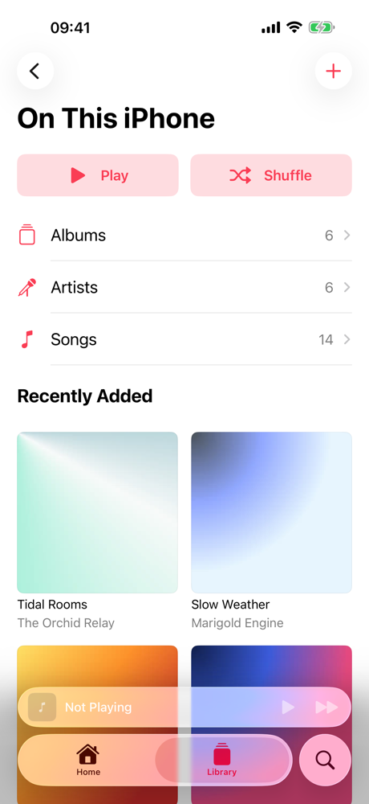
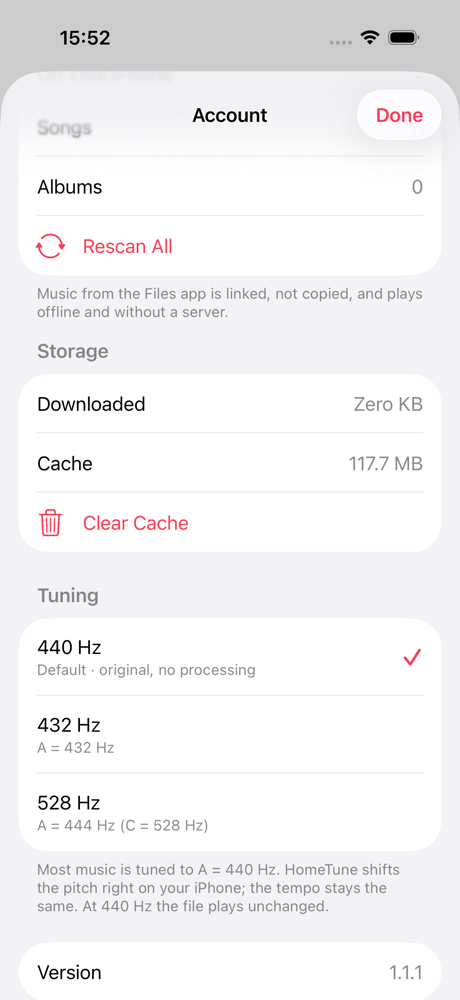
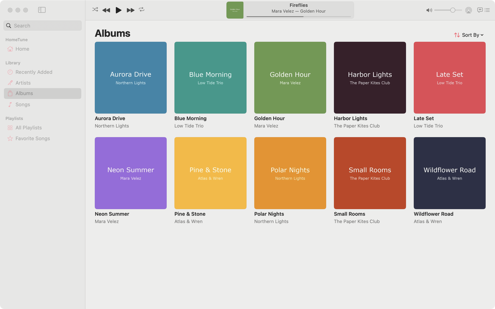
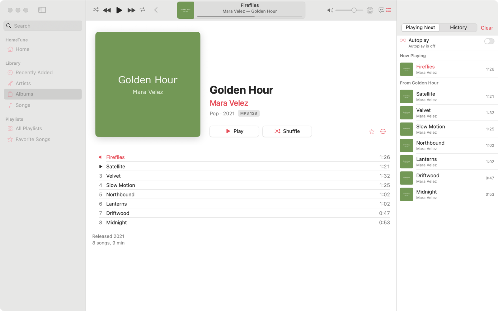
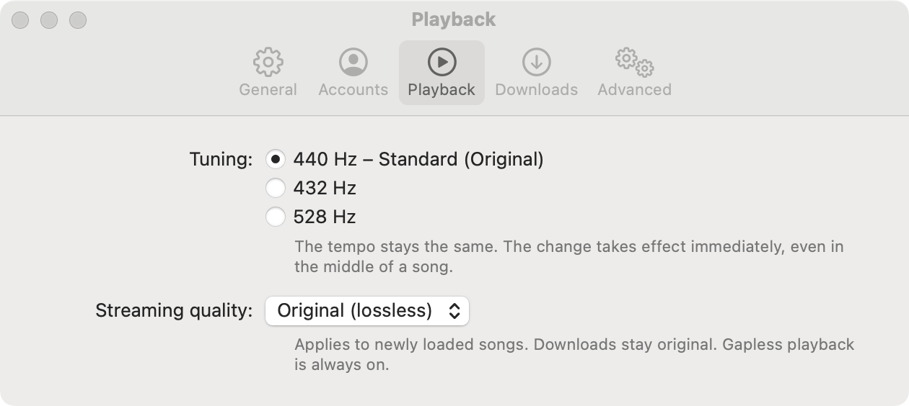

# HomeTune

**A native iOS music app for your own [Navidrome](https://www.navidrome.org) server – the look and feel of the Library in Apple's Music app: lossless FLAC up to 24/96, gapless playback, offline downloads, synced lyrics and music stored on the iPhone itself.**

HomeTune is an independent iPhone and Mac client for self-hosted Navidrome (or any Subsonic/OpenSubsonic server). It aims to feel like the Music app on iOS 26 (library sections, album and artist pages, mini player, full-screen player, "Playing Next" queue, lyrics …) while your music stays on hardware you own.

> **Status:** iPhone app 1.1.1, Mac app 1.2.0 ([see below](#hometune-for-mac)), tested against Navidrome 0.64 with MP3, AAC/ALAC and FLAC (up to 24 bit/96 kHz). UI in **English and German** (follows the iPhone language). Code comments are in German.
>
> Built with help from [Claude Code](https://claude.com/claude-code): Apple's Music app was analysed (names and texts only, see the HomeRoll series), the design decisions and testing are mine, a lot of the Swift was written together with it.
>
> **Personal project:** no guarantees, no support promises. Bug reports and pull requests are welcome, but I answer when I have time.
>
> Not affiliated with Apple or Navidrome. "Navidrome" is a trademark of its owners.

<p align="center">
  
  
  
  
  
</p>
<p align="center">
  
  
  
  
  
</p>
<p align="center"><sub>Screenshots with generated demo albums, made-up artists and demo lyrics (no real music).</sub></p>

## HomeTune for Mac

A native macOS app (SwiftUI, macOS 15 or newer, version 1.2.0) that looks and works like the Music app on the Mac – same server, same engine and tuning as on the iPhone.

<p align="center">
  
</p>
<p align="center">
  
  
</p>

- **Player in the toolbar**: shuffle · back · play/pause · forward · repeat, an LCD with cover, title, “artist — album”, progress line (hover for times and scrubbing, “⋯” menu), app volume and output device (incl. AirPlay speakers – only for HomeTune, the system output stays untouched)
- **Sidebar** with search field, Home, Library (Recently Added, Artists, Albums, Songs by default; Genres, Composers, Compilations, Downloaded and On This Mac via *Edit*) and Playlists
- **Song table** like Music: sort by clicking a header (remembered per view), show/hide, move and resize columns (right-click the header), multiple selection, double-click or Return plays, ★ column, download state, Delete removes from a playlist, Copy
- Album grid with hover play/“⋯”, album pages with disc headers, artists split view, genres and composers, playlists (create, rename, describe, reorder by dragging, delete), All Playlists, Favorite Songs
- **Playing Next / History** and **synced lyrics** in the right column; drag songs, albums, artists or playlists onto a playlist in the sidebar or into Playing Next; “Keep queue?” question like Music
- Full menu bar with Music’s shortcuts (Space, ⌘→/⌘←, ⌥⌘→/⌥⌘←, ⌘L, ⌘↑/⌘↓, ⌘N, ⇧⌘N, ⌘I, View menu with *Only Downloaded Music*, filter field ⌥⌘F, ⌥⌘U, ⌃⌘U, ⌘/, ⌃⌘1–6 …), context menus everywhere, Dock menu
- Media keys and *Now Playing* in Control Center, playback continues when the window is closed, MiniPlayer (⌥⌘M) and full-screen player (⇧⌘F)
- **Settings**: General (list size, favorites column, library items), Accounts (several servers, test connection, rescan), Playback (**tuning 440 Hz – original / 432 Hz / 528 Hz**, streaming quality), Downloads (location, remove all, cache), Advanced
- **On This Mac**: add folders or files (⌘O, drag from Finder) – they are only linked, never copied or deleted; music put into `~/Music/HomeTune` appears automatically. App data lives in `~/Library/Application Support/HomeTune` and `~/Library/Caches/HomeTune`.
- The queue is kept separately per device (iPhone and Mac don’t share it).

**Install:** download `HomeTune-mac.zip` from the Releases page (when available), unzip, move `HomeTune.app` to *Applications*. The app is ad-hoc signed: the first time, right-click → *Open* (or allow it under *System Settings › Privacy & Security*). macOS asks once for local network access when your server is in your home network. Build it yourself: `./build-mac.sh --install` (see below).

## Features

**Library**
- Sections like Music: Playlists, Artists, Albums, Songs, Genres, Composers, Favorite Songs, Downloaded – show, hide and reorder them (*Edit*)
- *Recently Added* grid below the sections, a Home tab with Recently Played, Recently Added, Heavy Rotation, Favorites, Random Albums and *Shuffle All*
- Sort (title, artist, recently added, recently played, release date, A–Z/Z–A), filter (favorites, downloaded), grid or list, *Find in …*
- Album pages with disc grouping, format line (e.g. `FLAC 24/96`), "More by …"; artist pages with top songs and albums
- Context menus per object type (song, album, artist, playlist, genre) and swipe actions (*Play Next* / *Play Last*), like Apple's menu providers
- Favorites (stars) synced with Navidrome, offline library cache

**Playback**
- Original files (`stream?format=raw`), so FLAC and ALAC stay lossless; formats iOS can't read are fetched as FLAC from the server
- Files play untouched by default (bit-exact). Optional in *Settings → Tuning*: pitch-shift on the device to A = 432 Hz or A = 444 Hz ("528 Hz") with the tempo unchanged, switchable mid-song without a click – details and measurements in [docs/TUNING.md](docs/TUNING.md)
- `AVAudioEngine` → own Audio Unit with [signalsmith-stretch](https://github.com/Signalsmith-Audio/signalsmith-stretch) (time-stretch, tempo-preserving) + band-limited resampling (exact pitch ratio, tempo exactly 100 %) → look-ahead peak limiter; ≈ 0.12 s fixed latency
- **Gapless**: the next song is preloaded and scheduled sample-exactly behind the current one
- Queue modelled after Apple's: *Play Next*, *Play Last*, *Continue Playing from …*, history, drag to reorder, swipe to remove, *Clear*; shuffle and repeat (off/all/one); the queue survives a restart
- Mini player as `tabViewBottomAccessory`, full-screen player with zoom transition, cover colors, scrubbing, volume, AirPlay
- Lock screen / Control Center / headphone controls (play, pause, next, previous, scrubbing, shuffle, repeat), background audio, interruptions and route changes
- Synced lyrics (OpenSubsonic `songLyrics`): current line highlighted, tap a line to jump; plain lyrics as fallback
- Scrobbling ("now playing" + played after 50 % or 4 minutes)

**Playlists, search, downloads, accounts**
- Create, rename, describe, add music, reorder, remove songs, delete; "already in playlist" prompt; *Discard Changes?*
- **Playlists on this iPhone** (also without a server): same editor, marked *On This iPhone* in the list, can hold local and server songs; *Add to Playlist* from every context menu
- **Import .m3u/.m3u8/.pls** (e.g. exported from Apple Music/iTunes on a Mac) via *Add Files …*, *Import Playlist …* or *Open in*; songs are matched by file name (without path/extension, case-insensitive, folder names break ties), then by the `#EXTINF` display name – "x of y songs found". Playlist files inside an added folder or the HomeTune folder are imported automatically and follow the file
- Search tab (iOS 26 search role) with recent searches, genre categories, top result, artists, albums, songs, playlists
- Downloads for offline listening (original files), per account; offline mode falls back to downloaded music
- Several servers/accounts, switchable; password in the Keychain

**Music on this iPhone**
- **HomeTune folder**: the app has its own folder in the Files app (*On My iPhone › HomeTune*, also visible in the Finder on a Mac via file sharing). Move music there – it appears automatically (on launch, when the app comes to the foreground and while it is open), subfolders included; deleted files disappear. No Files dialog needed
- *Add Folder …* / *Add Files …* (Library menu, empty state, *On This iPhone*): pick folders and files in the Files app, multiple selection, folders are searched recursively
- Files are **referenced, not copied** – a security-scoped bookmark per folder plus the relative path; stale bookmarks are renewed, rescanning finds new and deleted files
- Tags are read on the device (title, artist, album, album artist, track/disc, year, genre, composer, duration, cover – FLAC/Opus Vorbis comments and pictures included, file name as fallback)
- Own *On This iPhone* section with albums, artists and songs; the music also appears in the normal lists and in Search, with the same rows and album pages
- Same playback path: chosen tuning, gapless queue, lock screen with cover – offline and **without a server account** (*Continue Without a Server*)
- *Open in HomeTune* / *Share*: files from the Files app are opened in place and referenced like in the dialog; only real inbox copies (Mail, AirDrop, other apps) are stored as a copy
- If the sideloading profile only covers a different app ID, the Files dialog can't hand over files; *On This iPhone* then shows which bundle ID to set

### Music on this iPhone

HomeTune also works without a server. On the sign-in screen tap **Continue Without a Server**, then *Add Folder …* or *Add Files …*. You can add a Navidrome account later in *Account*. Details and limits: [docs/SETUP.md](docs/SETUP.md#music-on-this-iphone-no-server-needed).

- Supported: FLAC, MP3, AAC/M4A, ALAC, WAV, AIFF, CAF and Opus (everything `AVAudioFile` can read on iOS).
- **Not supported** (iOS can't decode them): WMA, WavPack, APE, DSD – and Ogg **Vorbis** (iOS 26.3 opens Ogg Opus, but not Ogg Vorbis). From a Navidrome server these formats still play, because HomeTune fetches them as FLAC.
- *Remove from Library* never touches files outside the HomeTune folder. For files in the HomeTune folder you are asked whether the file should be deleted too (default: no). Files received via *Open in* from Mail/AirDrop are copies owned by the app.
- Favorites of local songs stay on the device; local songs can only be in playlists on this iPhone and are not scrobbled.

## Requirements

- A Navidrome server (tested with **0.64**) reachable from the iPhone – at home or via VPN. Other OpenSubsonic servers should work for the basics. Optional if you only want to play music that is already on the iPhone.
- Xcode 26, [XcodeGen](https://github.com/yonaskolb/XcodeGen) (`brew install xcodegen`)
- iPhone with iOS 26, Mac with macOS 15 or newer (Liquid Glass touches on macOS 26)

## Install without a Mac

You need your own Navidrome server for this. **Step-by-step guide (server with Docker, access from outside, install): [docs/SETUP.md](docs/SETUP.md).**

1. Download `HomeTune-<version>.ipa` from the Releases page of this repository.
2. Install it with [SideStore](https://sidestore.io) or [AltStore](https://altstore.io). A free Apple ID is enough, the app then has to be refreshed every 7 days (SideStore does that on the phone).
3. Open the app and sign in with your Navidrome address and account.

## Build & install

```bash
git clone https://github.com/<you>/hometune.git
cd hometune
xcodegen generate
open HomeTune.xcodeproj
```

1. Set your own **bundle identifier** in `project.yml` (default: `org.homeroll.hometune`) and select your team in Xcode.
2. Run on your iPhone. Sign in with your server address (e.g. `https://music.example.com` or `http://192.168.x.y:4533`) and your Navidrome account.
3. Unsigned IPA for sideloading (AltStore/SideStore): `./build-ipa.sh`.
4. Mac app: scheme **HomeTuneMac** (bundle `org.homeroll.hometune.mac`). `./build-mac.sh` builds a Release app from a clean clone under `/private/tmp/hrb/…`, signs it ad hoc and checks that no user name or home path ends up in the binary; `./build-mac.sh --install` also copies it to `/Applications/HomeTune.app`.

### Tests and simulator with a test account

Put the test server into the git-ignored file `.test-account` (never commit it):

```bash
HOMETUNE_SERVER=http://<server>:4533
HOMETUNE_USER=<account that sees all libraries>
HOMETUNE_PASSWORD=...
HOMETUNE_DEMO_USER=<account with demo music only>
HOMETUNE_DEMO_PASSWORD=...
```

```bash
SIM=<simulator-udid> ./test.sh      # unit tests (API, queue, tuning FFT, engine, local music, playlists) + UI tests
TEST_RUNNER_UI_LANG=en TEST_RUNNER_SHOT_DIR=/tmp/shots SIM=<udid> ./test.sh -only-testing:HomeTuneUITests   # English screenshots
SIM=<simulator-udid> ./sim-run.sh   # start the app signed in (debug builds only)
./tools/make-test-audio.sh          # regenerate Tests/Fixtures (sine tones/silence with made-up tags, needs ffmpeg)
SIM=<udid> ./tools/sim-files.sh && TEST_RUNNER_PICKER=1 SIM=<udid> ./test.sh -only-testing:HomeTuneUITests/LocalMusicFlowTests   # also drive the real Files dialog
```

**Mac:** `./test-mac.sh` runs the unit tests of the shared core directly on the Mac (no simulator, no UI tests that would take over mouse and keyboard). `DEMO=1 ./run-mac.sh` starts the debug app (“HomeTune Test”, own folders, password only in memory) signed in with the demo account; `swift tools/mac-debug.swift "go albums" "album Golden Hour" "inspector queue" "snapshot /tmp/a.png"` drives it without mouse and keyboard and captures only its own window (`APP_LANG=en` for English).

Debug builds can import local music without the Files dialog: `HOMETUNE_LOCAL_IMPORT=<folder>|<folder>`, `HOMETUNE_SIGNED_OUT=1`, `HOMETUNE_LOCAL_RESET=1` (launch environment).

Regenerate the English strings after adding texts: build the iPhone and the Mac app once, then `python3 tools/make-strings.py`. App icon: `swift tools/make-icon.swift Resources/Assets.xcassets/AppIcon.appiconset`.

## Privacy

- The app talks **only** to your Navidrome server. No analytics, no third-party SDKs.
- Music on this iPhone never leaves the device: tags and covers are read locally, only bookmarks, tags and small cover thumbnails are stored in the app.
- All API calls are sent as POST forms with token authentication (`t`/`s`), so the password never appears in URLs or server logs; the password itself stays in the iPhone Keychain.
- Pitch shifting happens on the device; the server only delivers the original files.
- The HomeTune folder (Documents) only contains your music – caches, covers and the local library database live in the app's private storage.

## Project layout

```
Shared/API        Subsonic/OpenSubsonic client and models
Shared/Audio      tuning chain (Audio Unit with signalsmith-stretch, Objective-C++), decoder, gapless engine, track cache
Shared/Player     queue (Apple's model) and player controller (lock screen / Now Playing, remote commands, scrobbling)
Shared/Core       accounts, library index, actions, artwork, app paths (own folders on the Mac)
Shared/Downloads  offline downloads
Shared/Local      local music: HomeTune folder, bookmarks, folder scan, tag reader (incl. FLAC/Opus), playlists (m3u/pls)
App/              iPhone app: SwiftUI views, Files dialog, signing check
Mac/              Mac app: main window, sidebar, song table, player toolbar/LCD, queue & lyrics, search, menus, settings, MiniPlayer
Tests             unit tests (API against a test server, queue, FFT measurement, live engine, local music, Mac paths) – iOS and macOS
Tests/Fixtures    generated test audio (tools/make-test-audio.sh)
UITests           iPhone UI flow tests and screenshots
tools             icon and strings generators, Mac debug remote
Vendor            signalsmith-stretch + signalsmith-linear (headers, MIT)
```

## License

[GPL-3.0](LICENSE) (GNU General Public License v3.0; releases up to this change were published under MIT).

**Third-party:**
- [signalsmith-stretch](https://github.com/Signalsmith-Audio/signalsmith-stretch) (time-stretching) and [signalsmith-linear](https://github.com/Signalsmith-Audio/linear) (FFT/STFT) by Signalsmith Audio – MIT, vendored in `Vendor/` with their license files ([Vendor/README.md](Vendor/README.md)).
- Navidrome (GPL-3.0) is not included – HomeTune only talks to its HTTP API.

---

<!-- home-apps:start -->
## More Home apps

Same idea, other Apple apps – all free, open source and self-hosted:

- **[HomeRoll](https://github.com/silentprovider423/HomeRoll)** – Photos · Immich
- **[HomeRoll Desktop](https://github.com/silentprovider423/HomeRoll-Desk)** – Photos for Mac · Immich
- **[HomeRoll TV](https://github.com/silentprovider423/HomeRoll-TV)** – Photos for Apple TV · Immich
- **[HomeNotes](https://github.com/silentprovider423/HomeNotes)** – Notes · Nextcloud
- **[HomePost](https://github.com/silentprovider423/HomePost)** – Mail · IMAP/SMTP or JMAP
- **[HomeFind](https://github.com/silentprovider423/HomeFind)** – Find My · Dawarich
- **[HomeCast](https://github.com/silentprovider423/HomeCast)** – Podcasts · PinePods
- **[HomeThread](https://github.com/silentprovider423/HomeThread)** – notes to self · own server (Docker)

All apps: [github.com/silentprovider423](https://github.com/silentprovider423)
<!-- home-apps:end -->

## Deutsch

**HomeTune** ist eine eigene iPhone-Musik-App für deinen selbst betriebenen Navidrome-Server. Sie sieht aus und bedient sich wie die Mediathek von Apples Musik-App unter iOS 26 – verlustfrei (FLAC bis 24/96), lückenlos, offline und mit mitlaufenden Songtexten. Die Dateien laufen standardmäßig unverändert; wer möchte, kann in den Einstellungen eine andere Stimmung wählen (432 Hz oder 528 Hz, Tempo bleibt gleich). Die Oberfläche gibt es auf Deutsch und Englisch, je nach Sprache des iPhones. Funktionen, Voraussetzungen und Installation stehen oben.

**Mac:** Seit 1.2.0 gibt es HomeTune auch als Mac-App (ab macOS 15). Sie sieht aus wie die Musik-App auf dem Mac: Player in der Symbolleiste, Seitenleiste mit Suche, Titeltabelle mit Spalten und Sortierung, „Nächster Titel“ und Liedtext rechts, Menüleiste mit den bekannten Kürzeln, MiniPlayer und Vollbild-Player. Die Stimmung (440 Hz Original, 432 Hz, 528 Hz) steht in den Einstellungen unter *Wiedergabe*. Musik „Auf diesem Mac“ wird nur verknüpft, nie kopiert oder gelöscht; der eigene Ordner ist `~/Music/HomeTune`.

**Musik auf diesem iPhone:** Auch ohne Server nutzbar („Ohne Server fortfahren“). Über *Ordner hinzufügen …* / *Dateien hinzufügen …* wählst du Musik in der Dateien-App (FLAC, MP3, AAC, ALAC, WAV, AIFF). HomeTune kopiert nichts, sondern merkt sich per Bookmark, wo die Dateien liegen, liest die Tags auf dem Gerät und spielt sie in der gewählten Stimmung – offline, mit Warteliste und Sperrbildschirm. Noch einfacher: Musik in der Dateien-App nach *Auf meinem iPhone › HomeTune* verschieben, sie erscheint automatisch. Eigene Playlists gibt es auch ohne Server, .m3u/.m3u8/.pls lassen sich importieren.
